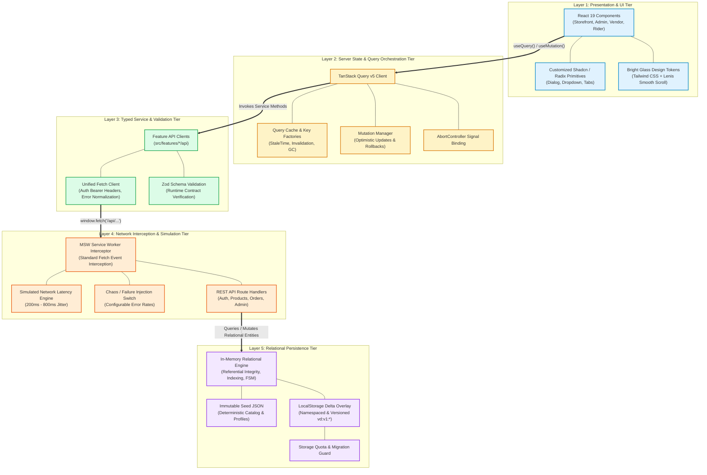
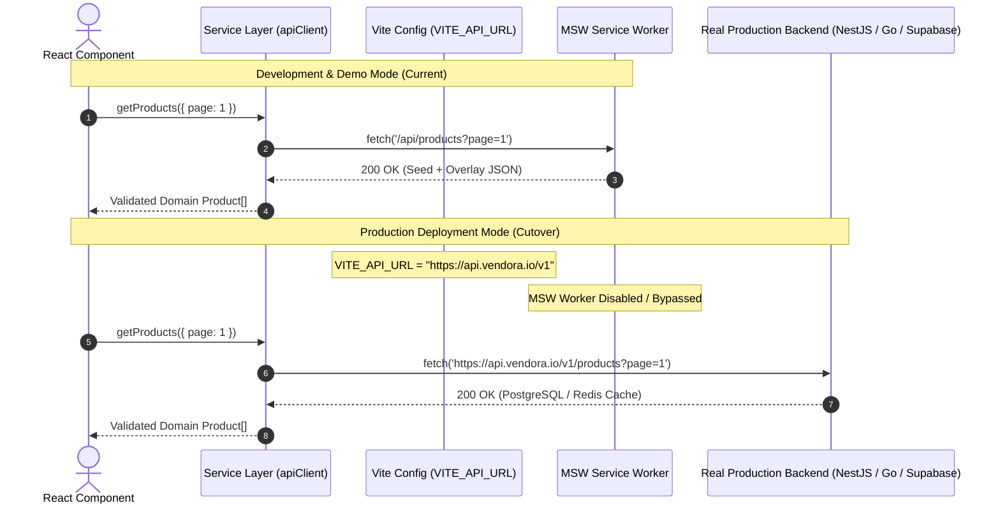
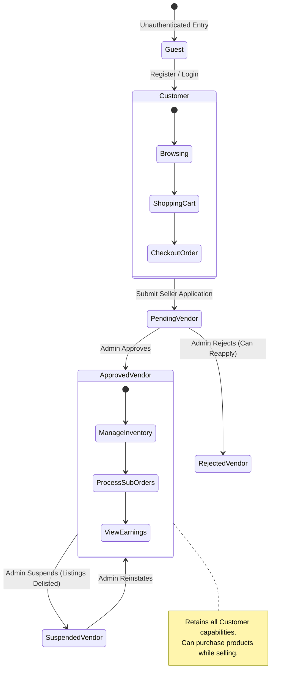
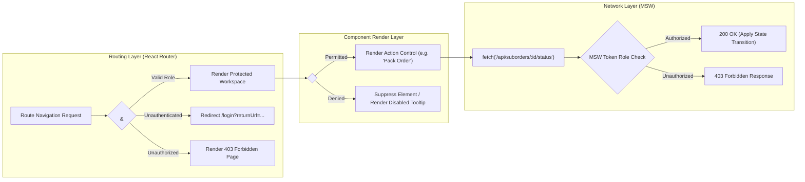
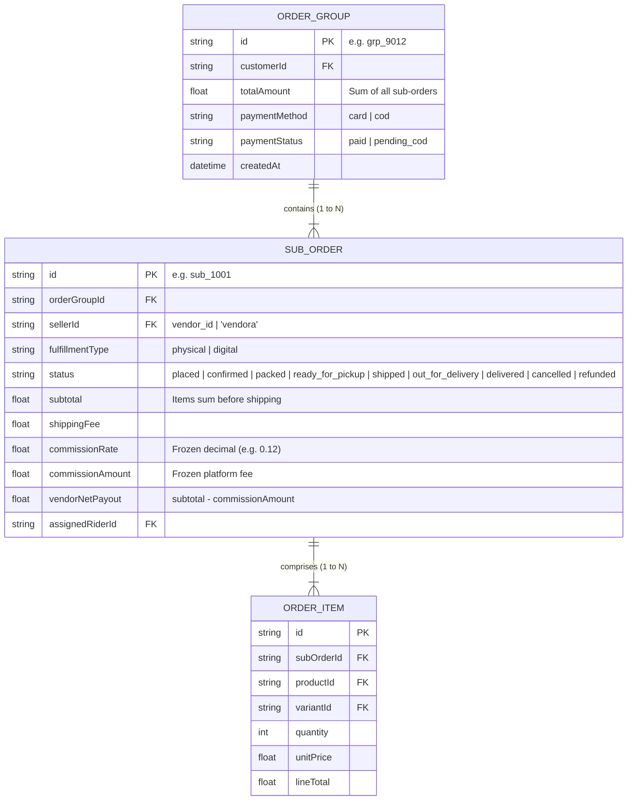
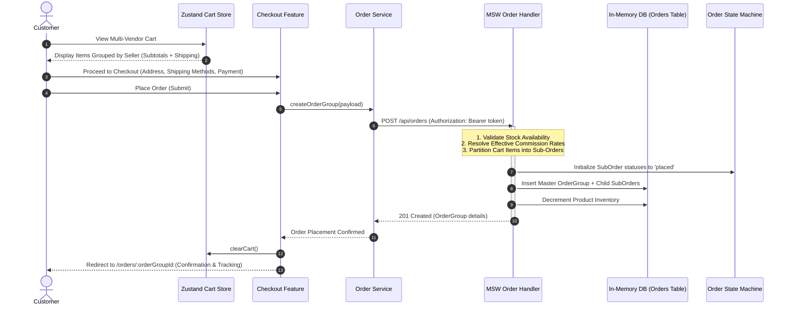
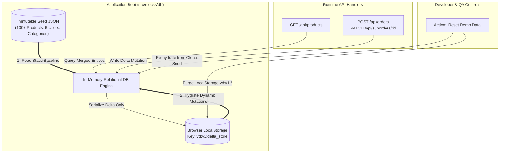

# Vendora Architecture Specification

**Project:** Vendora — Enterprise Multi-Vendor Marketplace Frontend  
**Role:** Technical Writer & Solutions Architect  
**Version:** 1.0.0 (Mentor Review Edition)  
**Status:** Approved for Implementation  
**Target Environment:** Modern Evergreen Browsers (Vite + React 19 + TypeScript Strict)  

---

## 1. Executive Summary & Architectural Tenets

Vendora is an Amazon-style multi-vendor marketplace frontend engineered to deliver commercial-grade capabilities, rigorous state discipline, and backend-agnostic decoupling. Operating entirely client-side for demonstration and assessment, Vendora eliminates external runtime backend dependencies by embedding a high-fidelity **Mock Service Worker (MSW)** HTTP interception tier coupled with an **In-Memory Relational Database** backed by a **LocalStorage Delta Overlay**.

### Core Architectural Tenets

1. **Zero Backend Coupling via Clean Layered Boundaries**:  
   React UI components have zero awareness of the mock engine or persistence mechanics. All data access transpires through typed domain hooks calling isolated API service clients via standardized `fetch()` calls. Swapping MSW for a real distributed backend (e.g., NestJS, Go, Supabase) requires modifying only the `VITE_API_URL` environment variable; zero presentation components require modification.
2. **Strict State Partitioning**:  
   State is rigorously categorized by its true domain lifecycle. Server state is never duplicated inside client stores. Client state is kept minimal, synchronous, and selector-driven. URL parameters act as the single source of truth for navigation, discovery, and filterable views.
3. **Predictable Unidirectional Data Flow**:  
   Data mutations follow strict state machine lifecycles (particularly multi-vendor split orders and listing moderation). Optimistic updates are backed by transactional rollback protocols.
4. **Defensive Performance Engineering**:  
   The application prevents rendering waterfalls through route-level code splitting, selective memoization driven by profiler evidence, input debouncing, request cancellation via `AbortController`, and isolated smooth scrolling coordination.
5. **Dual-Tiered Role Enforcement (RBAC)**:  
   Security is conceptualized as two independent layers: user-experience route and UI visibility guards (`<Can />` and protected route wrappers) on the client, and strict HTTP 401/403 authorization enforcement within the mock API network boundary.

---

## 2. End-to-End System Diagram & Layered Architecture

Vendora implements a strict 5-tier layered architecture ensuring separation of concerns, testability, and deterministic runtime behavior.

### 2.1 Layered Architecture Diagram

---

### 2.2 Deep Dive: Architectural Layers

#### Layer 1: Presentation & UI Tier
* **Technology**: React 19, TypeScript (Strict), Tailwind CSS, Shadcn / Radix UI, Lenis Smooth Scroll.
* **Responsibilities**:
  * Render accessible, responsive view layouts across desktop, tablet, and mobile screens.
  * Implement the *Bright Glass* aesthetic using balanced translucent fills, backdrop blur, pill controls, and crisp contrast levels (>= 4.5:1).
  * Maintain zero direct business logic or persistence logic; components consume data exclusively through custom query hooks (`useProducts`, `useOrders`, `useVendorEarnings`) and dispatch UI interactions via mutation hooks.
  * Delegate accessibility and keyboard mechanics to unstyled Radix UI primitives.

#### Layer 2: Server State & Query Orchestration Tier
* **Technology**: TanStack Query v5 (`@tanstack/react-query`).
* **Responsibilities**:
  * Manage caching, background revalidation, cache garbage collection, and query deduplication.
  * Structure cache invalidation using deterministic **Query Key Factories** (e.g., `productKeys.detail(id)`, `orderKeys.list(filters)`).
  * Automatically forward `AbortSignal` instances from query execution contexts down to the native fetch client to cancel superseded HTTP requests immediately (eliminating race conditions).
  * Execute optimistic UI updates with automatic snapshot rollback upon network rejection (e.g., wishlist toggles, instant cart quantity adjustments).

#### Layer 3: Typed Service & Validation Tier
* **Technology**: Native `fetch`, Zod runtime validation.
* **Responsibilities**:
  * Provide strongly typed API adapter functions located under `src/features/<feature>/api/`.
  * Centralize HTTP header injection (e.g., `Authorization: Bearer <simulated_jwt>`).
  * Validate API response payloads at runtime via Zod schemas before emitting data to query hooks, catching contract mismatches at the boundary.
  * Transform raw REST payload shapes into consumer-friendly domain entities.

#### Layer 4: Network Interception & Simulation Tier
* **Technology**: Mock Service Worker v3 (MSW).
* **Responsibilities**:
  * Intercept native browser `fetch` requests at the Service Worker level before network dispatch.
  * Emulate realistic network behavior: introduce pseudo-random artificial latency ($200\text{ms} - 800\text{ms}$), compute HTTP status codes (200, 201, 400, 401, 403, 404, 409, 500), and inject configurable network failure rates for chaos testing.
  * Enforce mock authentication and authorization checks (rejecting requests lacking proper role claims).

#### Layer 5: Relational Persistence Tier
* **Technology**: In-Memory Relational Engine with LocalStorage Delta Overlay.
* **Responsibilities**:
  * Combine an immutable, statically imported seed catalog snapshot with a mutable browser `localStorage` layer.
  * Keep the browser storage footprint below the 5MB browser quota by storing **only deltas** (newly placed orders, modified inventory counts, customer reviews, newly registered products).
  * Isolate domain tables under versioned keys (`vd:v1:orders`, `vd:v1:products_delta`, `vd:v1:users`).
  * Enforce entity relationships, cascade deletions, and finite state machine transitions.

---

### 2.3 Migration Path to Production Backend

The architecture is explicitly constructed to make backend transition an additive configuration step rather than an application rewrite:

**Cutover Checklist**:
1. Configure `VITE_API_URL` to point to the live API gateway.
2. Toggle off `enableMocking()` in `src/main.tsx`.
3. The service layer (`src/features/*/api`) and UI components require zero code modifications.

---

## 3. State Classification Matrix

To eliminate state duplication, race conditions, and synchronization bugs, Vendora establishes a strict taxonomy of state types. Server data is **never copied** into client stores.

| State Category | Definition & Scope | Canonical Storage Tool | Lifecycle & Invalidation Triggers | Concrete Vendora Examples | Forbidden Anti-Patterns |
| :--- | :--- | :--- | :--- | :--- | :--- |
| **Server State** | Asynchronous data residing remotely that the client does not own, but caches temporarily. | **TanStack Query Cache** | Invalidation via mutations, cache timer expiry (`staleTime: 60s`, `gcTime: 5m`), window focus, explicit refetch. | Product catalog, product details, orders, vendor sales metrics, disputes, platform commission rules. | **Never** copy server data into Zustand or React local state. Do not dispatch fetched data to a "productStore". |
| **Persistent Client State** | Synchronous client-owned data that must survive page reloads and cross-session navigation. | **Zustand Store** with `persist` middleware | Explicit user actions (Add to Cart, Login, Logout, Clear Preferences); cross-tab storage sync. | Active Cart items, user session token, guest wishlist, compare drawer items, table density preference. | **Never** place catalog search queries, pagination indices, or transient form drafts into persistent stores. |
| **URL State** | State defining the current view parameters, shareable via link and navigable via Back/Forward. | **URLSearchParams** (React Router) | Route navigation, query string modification, browser history traversal (`pushState` / `replaceState`). | Search query (`?q=`), category filter (`?category=`), sort order (`?sort=`), pagination (`?page=`), active tab (`?tab=`). | **Never** duplicate URL filter params in component `useState`. Never require button clicks to sync filters to URL. |
| **Form State** | Transient user input values undergoing active entry, validation, and submission handling. | **React Hook Form** + **Zod** | Form mount/unmount, input change, blur validation, form submit, form reset. | Multi-step checkout address/card fields, vendor product creation form, seller onboarding application. | **Never** sync every raw keystroke to a global Zustand store or URL parameters. |
| **Ephemeral UI State** | Short-lived visual or interaction states scoped to a single component or immediate parent. | Local `useState` / `useReducer` | Component unmount, outside click, ESC keypress, modal toggle, layout transition. | Modal open/close, mobile accordion step expansion, tooltip visibility, hover states, review card expansion. | **Never** hoist transient dialog booleans into global Zustand stores unless driven by global modals. |
| **Derived State** | Values computed purely from existing state sources without independent lifecycles. | Pure Selectors / `useMemo` | Re-evaluated synchronously when underlying dependency state references change. | Cart subtotal/tax/shipping totals, order group aggregate status, vendor commission payout deduction. | **Never** store derived totals in Zustand or DB state (prevents state desynchronization bugs). |

---

## 4. Role-Based Access Control (RBAC) & Permission Map

Vendora supports six distinct user roles across the platform. Access control is modeled around an extensible capabilities matrix.

### 4.1 The Six User Personas & Workspaces

1. **Guest**: Unauthenticated visitor browsing the global catalog, building a guest cart, and utilizing product comparisons.
2. **Customer**: Authenticated consumer with access to checkout, multi-vendor order history, tracking, digital asset downloads, disputes, and vendor application.
3. **Vendor**: Approved independent seller managing their own product catalog, fulfilling assigned sub-orders, inspecting sales analytics, and tracking platform commission deductions.
4. **Admin**: Superuser possessing unrestricted governance over vendor onboarding, product catalog moderation, platform-wide commission rules, user account lifecycles, and financial reporting.
5. **Support Agent**: Customer care specialist managing dispute queues, inspecting order audit trails, issuing customer replies, adding internal notes, and escalating to admins.
6. **Delivery Rider**: Logistics operator assigned to physical sub-order fulfillment, managing pickup transitions, updating in-transit statuses, recording delivery confirmation pins, and logging exceptions.

---

### 4.2 Comprehensive RBAC Permission Matrix

| Granular System Capability | Guest | Customer | Vendor | Admin | Support Agent | Delivery Rider |
| :--- | :---: | :---: | :---: | :---: | :---: | :---: |
| Browse public catalog & view product details | ✅ | ✅ | ✅ | ✅ | ✅ | ✅ |
| Add items to local cart & run comparisons | ✅ | ✅ | ✅ | ✅ | ✅ | ✅ |
| Execute checkout & place multi-vendor order | ❌ | ✅ | ✅ | ✅ | ❌ | ❌ |
| View own customer order history & tracking | ❌ | ✅ | ✅ | ✅ | ❌ | ❌ |
| Download purchased digital product license keys | ❌ | ✅ | ✅ | ✅ | ❌ | ❌ |
| File dispute / ticket against a sub-order | ❌ | ✅ | ✅ | ❌ | ❌ | ❌ |
| Submit seller onboarding application | ❌ | ✅ | ❌ | ❌ | ❌ | ❌ |
| Create & edit own vendor products (Draft/Submit) | ❌ | ❌ | ✅ | ✅* | ❌ | ❌ |
| Manage own vendor sub-orders (Pack/Ready Pickup) | ❌ | ❌ | ✅ | ✅ | ❌ | ❌ |
| View own vendor sales analytics & commission deductions | ❌ | ❌ | ✅ | ✅ | ❌ | ❌ |
| Moderate pending vendor listings (Approve/Reject) | ❌ | ❌ | ❌ | ✅ | ❌ | ❌ |
| Approve / reject / suspend vendor applications | ❌ | ❌ | ❌ | ✅ | ❌ | ❌ |
| Configure global & category commission rates | ❌ | ❌ | ❌ | ✅ | ❌ | ❌ |
| View platform-wide GMV, earnings, and financial reports | ❌ | ❌ | ❌ | ✅ | ❌ | ❌ |
| Triage dispute queue & post internal agent notes | ❌ | ❌ | ❌ | ✅ | ✅ | ❌ |
| Issue refunds / formal dispute settlements | ❌ | ❌ | ❌ | ✅ | ❌ | ❌ |
| View assigned deliveries & customer delivery address | ❌ | ❌ | ❌ | ❌ | ❌ | ✅ |
| Confirm package delivery via simulation code | ❌ | ❌ | ❌ | ❌ | ❌ | ✅ |

*\*Admin manages 1st-party products directly ("Sold by Vendora") without entering the moderation queue.*

---

### 4.3 Client-Side UI & Route Protection Architecture

* **Central Permission Map (`src/lib/rbac.ts`)**:  
  Contains pure evaluation functions (`hasPermission(userRole, ability)`). The entire application references this single source of truth.
* **Component-Level Guard (`<Can />`)**:  
  Declaratively renders UI controls based on permissions, preventing unauthorized actions from ever rendering.
* **Route Guards (`<RequireRole />`)**:  
  Intercepts nested route boundaries under `/vendor/*`, `/admin/*`, `/support/*`, and `/rider/*`.
* **Mock API Authorization Boundary**:  
  Every MSW handler decodes the incoming `Authorization: Bearer <token>` header. If a `Customer` attempts to POST to `/api/admin/commission`, MSW responds with `HttpResponse.json({ error: "Forbidden" }, { status: 403 })`.

---

## 5. Split-Order Data Flow & Commission Calculation Rules

### 5.1 The Multi-Vendor Commerce Problem

In a multi-vendor marketplace, a single customer shopping cart frequently contains items supplied by distinct merchants:
* Item A: Supplied by Vendor 1 (e.g., AudioTech Ltd — Physical Electronics)
* Item B: Supplied by Vendor 2 (e.g., StudioCraft — Physical Artisan Goods)
* Item C: Sold directly by the platform (Vendora First-Party — Digital License)

A unified checkout must process payment once, but fulfillment, delivery tracking, dispute management, and revenue payouts must be partitioned per vendor.

### 5.2 Split-Order Entity Model

---

### 5.3 End-to-End Split-Order Execution Flow

---

### 5.4 Commission Calculation & Freezing Rules

#### Resolution Hierarchy
When an order is placed, Vendora calculates the commission rate for each sub-order according to a strict priority hierarchy:

$$\text{Effective Commission Rate } (R_{\text{effective}}) = \begin{cases} 
R_{\text{vendor\_override}} & \text{if vendor has negotiated rate} \\ 
R_{\text{category\_override}} & \text{else if primary category has override} \\ 
R_{\text{global\_default}} & \text{otherwise (e.g., } 10\% \text{ default)} 
\end{cases}$$

#### Financial Computation Formulas
For each `SubOrder` containing $m$ line items:

$$\text{Subtotal} = \sum_{i=1}^{m} (\text{unitPrice}_i \times \text{quantity}_i)$$

$$\text{Commission Amount} = \text{round}\Big(\text{Subtotal} \times R_{\text{effective}}, \, 2\Big)$$

$$\text{Vendor Net Payout} = \text{Subtotal} - \text{Commission Amount}$$

$$\text{SubOrder Total Charged to Customer} = \text{Subtotal} + \text{ShippingFee} + \text{Tax}$$

> **Important — Payout and Shipping Separation**:  
> Platform commission applies **strictly to product subtotal**. Shipping fees collected from the customer are credited in full to the logistics fulfillment pool or vendor, never docked for platform commission.

#### The "Frozen Commission" Guarantee
* **Immutability Invariant**: The moment a sub-order transitions into the `placed` state, the exact `commissionRate` and `commissionAmount` are calculated and **frozen** directly into the `SubOrder` record in persistence.
* **Audit Protection**: If an administrator subsequently alters the global commission from $10\%$ to $15\%$ or updates category overrides, previously placed sub-orders **remain untouched**. Vendor payout statements and historical platform GMV reports maintain $100\%$ accounting integrity.

---

### 5.5 Order Group Status Derivation Matrix

An `OrderGroup` never stores an independent fulfillment status; its display status is computed synchronously as a derived projection of its constituent `SubOrders`:

| Constituent Sub-Order Statuses | Derived `OrderGroup` Display Status |
| :--- | :--- |
| All sub-orders are `delivered` | **Completed** |
| All sub-orders are `cancelled` | **Cancelled** |
| All sub-orders are `refunded` | **Refunded** |
| Any sub-order is `placed`, `confirmed`, `packed`, or `shipped` | **Processing (In Fulfillment)** |
| Mix of `delivered` and `shipped` / `packed` | **Partially Fulfilled** |
| Mix of `delivered` and `cancelled` / `refunded` | **Partially Completed** |

---

## 6. Seed Data & LocalStorage Delta Architecture

To ensure high data density (dozens of realistic products, reviews, categories, and test user accounts) without hitting the browser's 5MB `localStorage` limit, Vendora employs a **Hybrid Seed + Delta Overlay Strategy**.

### Key Mechanics:
1. **Base Catalog Invariance**: The static seed catalog is bundled with the application and loaded into memory on startup. It consumes zero localStorage bytes.
2. **Delta Persistence**: When an order is placed, a product edited, or a review written, only the created/updated entity is written to localStorage under the versioned key `vd:v1:delta_store`.
3. **Quota Protection**: A wrapped storage adapter catches `QuotaExceededError` exceptions and surfaces non-fatal alerts to the user interface, gracefully falling back to in-memory operation.
4. **Instant State Reset**: A prominent "Reset Demo Data" action in the application header or footer clears the `vd:v1:*` keys, returning the application to the exact baseline expected by the mentor test suite.
