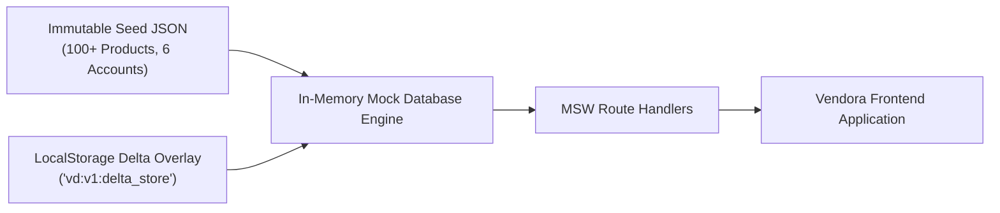
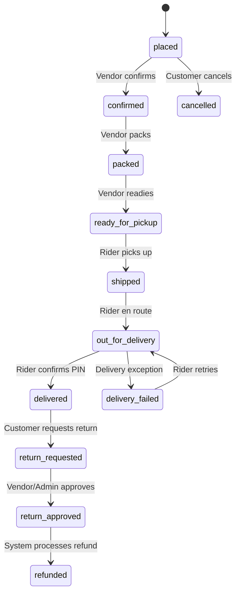
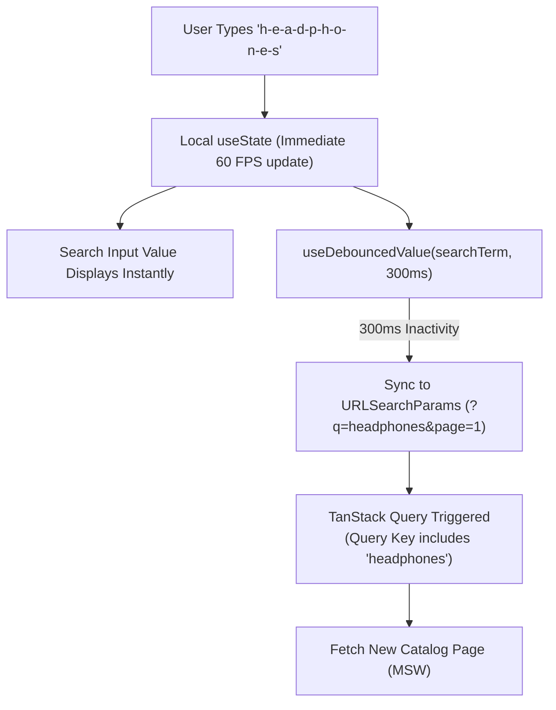
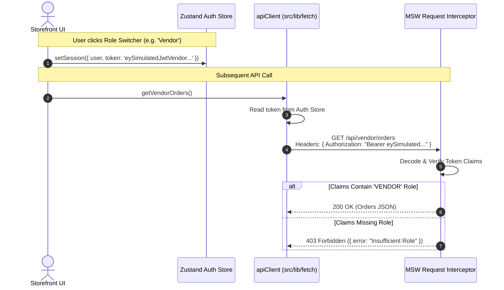

# Architecture Decision Records (ADRs)

**Project:** Vendora — Enterprise Multi-Vendor Marketplace Frontend  
**Status:** Accepted & Baseline for Evaluation  
**Author:** Technical Writer & Solutions Architect  
**Review Target:** Mentor Architecture & Code Evaluation  

---

## Document Overview & Index

Architecture Decision Records (ADRs) capture critical technical decisions made during the design and engineering of Vendora. Each record outlines the architectural problem, decision drivers, considered alternatives, the chosen resolution, and verifiable consequences.

| ADR # | Title | Status | Primary Domain |
| :--- | :--- | :---: | :--- |
| **ADR 001** | TanStack Query vs Redux for Server State Management | **Accepted** | Data Fetching & Caching |
| **ADR 002** | Zustand with Persist Middleware for Cart & Session Management | **Accepted** | Client State Architecture |
| **ADR 003** | In-Memory Relational Mock Database with LocalStorage Overlay | **Accepted** | Mock Infrastructure & Storage |
| **ADR 004** | Pure Finite State Machine for Split-Order Lifecycle | **Accepted** | Domain Logic & Order Workflow |
| **ADR 005** | Decoupled Local Input with Debounced URL Sync for Catalog Search | **Accepted** | UI Responsiveness & URL State |
| **ADR 006** | Controlled Lenis Smooth Scroll with Radix Overlay Pause | **Accepted** | UI Motion & Scroll Coordination |
| **ADR 007** | Bearer JWT Simulation over HTTP Headers vs Cookie Simulation | **Accepted** | Authentication & Security Emulation |

---

## ADR 001: TanStack Query vs Redux for Server State Management

### Status
**Accepted**

### Context & Problem Statement
In an enterprise multi-vendor marketplace, more than 85% of application state originates from the server: product listings, nested category trees, customer order histories, vendor earnings, product reviews, and dispute threads. 

Historically, single-page applications used global state containers (Redux, Redux Toolkit) to store this remote data. However, server state differs fundamentally from client state:
1. It is not owned by the client; it is a point-in-time remote snapshot.
2. It requires asynchronous orchestration: loading flags, error handling, retries, background revalidation upon window focus, query deduplication, and cache garbage collection.
3. Copying server payloads into global Redux stores creates synchronization bugs, stale data retention, boilerplate overhead (`extraReducers`, `createAsyncThunk`), and normalized entity management complexity.

### Decision Drivers
* **Boilerplate Reduction**: Avoid writing thousands of lines of reducers, action creators, and status flags (`isLoading`, `isError`).
* **Cache Synchronization**: Native support for automatic background refetching, query key hierarchy invalidation, and configurable stale timeouts.
* **Race Condition Mitigation**: Built-in cancellation propagation via standard `AbortSignal`.
* **Clean Decoupling**: Keep UI components independent from persistence and fetching mechanics.

### Considered Options
1. **Redux Toolkit (RTK) with Slices & Thunks**: Traditional global store approach.
2. **Redux Toolkit Query (RTK Query)**: RTK's built-in data fetching tool.
3. **TanStack Query v5 (`@tanstack/react-query`)**: Dedicated asynchronous server state management library.

### Decision Outcome
**Chosen Option: TanStack Query v5**.

TanStack Query treats server state as a managed asynchronous cache rather than static state. It provides out-of-the-box garbage collection, stale-time heuristics, window refocus refetching, and query key factories.

#### Comparison Matrix

| Capability / Factor | Redux Slices + Thunks | RTK Query | TanStack Query v5 |
| :--- | :--- | :--- | :--- |
| **Boilerplate Overhead** | High (actions, reducers, types) | Medium (API definitions) | **Minimal** (hooks + fetcher functions) |
| **Cache Invalidation** | Manual reducer manipulation | Tag-based (`providesTags`) | **Hierarchical Query Keys** (`queryClient.invalidateQueries`) |
| **Request Cancellation** | Manual `AbortController` wiring | Supported | **Automatic** (`signal` passed directly to `fetch`) |
| **Optimistic Updates** | High manual complexity | Supported with recipe | **First-Class** (`onMutate`, `onError`, `onSettled`) |
| **Bundle Footprint** | ~11 kB + RTK bundle | Part of `@reduxjs/toolkit` (~30 kB) | **~13 kB** standalone |

### Implementation Pattern
Vendora implements structured **Query Key Factories** to ensure consistent cache addresses and predictable invalidation patterns:

```typescript
// src/features/catalog/api/queryKeys.ts
export const productKeys = {
  all: ['products'] as const,
  lists: () => [...productKeys.all, 'list'] as const,
  list: (filters: ProductFilterParams) => [...productKeys.lists(), filters] as const,
  details: () => [...productKeys.all, 'detail'] as const,
  detail: (id: string) => [...productKeys.details(), id] as const,
};

// Usage inside domain hook
export const useProducts = (filters: ProductFilterParams) => {
  return useQuery({
    queryKey: productKeys.list(filters),
    queryFn: ({ signal }) => fetchProducts(filters, signal),
    staleTime: 1000 * 60, // 60 seconds fresh
    gcTime: 1000 * 60 * 5, // 5 minutes retention
  });
};
```

### Consequences
* **Positive**: Eliminated hundreds of lines of action/reducer boilerplate; instantaneous cache invalidation upon mutations; zero stale data lingering across routes; automatic request cancellation eliminates race conditions.
* **Negative**: Requires engineers to strictly respect the rule that server data is never copied into client stores.
* **Neutral**: Components must wrap asynchronous views in standardized loading/error handling components (`<QueryState />`).

---

## ADR 002: Zustand with Persist Middleware for Cart & Session Management

### Status
**Accepted**

### Context & Problem Statement
While server state is delegated to TanStack Query, the application requires persistent, highly reactive client-only state:
1. **Multi-Vendor Cart**: Items must be stored locally for guest shoppers, persist through page reloads, and merge with account carts upon login.
2. **Authentication Session**: Simulated JWT tokens, user role claims, and active persona profiles.
3. **Client UI Preferences**: Dismissed announcements, comparison drawer state, and listing layout preferences (grid vs. table).

React Context causes broad sub-tree re-renders whenever any context property updates, while Redux introduces unnecessary ceremony and bundle weight for simple client-side values.

### Decision Drivers
* **Render Performance**: Fine-grained selector subscriptions so components re-render only when their specific slice changes.
* **Simplicity & Zero Boilerplate**: Hook-based store definition without actions/reducers ceremony.
* **Native Storage Synchronization**: Seamless serialization to `localStorage` with versioned migration support.
* **Lightweight Bundle**: Negligible footprint (< 2 kB).

### Considered Options
1. **React Context API with `useReducer`**: Built-in, but triggers full sub-tree re-renders on every cart item increment.
2. **Redux Toolkit**: Proven, but introduces excessive overhead for simple client preferences and cart items.
3. **Zustand with `persist` Middleware**: Lightweight, selector-driven micro-store.

### Decision Outcome
**Chosen Option: Zustand with `persist` Middleware**.

Zustand provides a minimal, scalable store architecture. Its selector pattern ensures that a component observing `cart.items.length` does not re-render when a customer modifies product shipping options in the checkout step.

### Implementation Pattern

```typescript
// src/store/cartStore.ts
import { create } from 'zustand';
import { persist, createJSONStorage } from 'zustand/middleware';

interface CartState {
  items: CartItem[];
  addItem: (item: CartItem) => void;
  removeItem: (itemId: string) => void;
  updateQuantity: (itemId: string, quantity: number) => void;
  clearCart: () => void;
}

export const useCartStore = create<CartState>()(
  persist(
    (set) => ({
      items: [],
      addItem: (item) =>
        set((state) => {
          const existing = state.items.find((i) => i.id === item.id && i.variantId === item.variantId);
          if (existing) {
            return {
              items: state.items.map((i) =>
                i.id === item.id && i.variantId === item.variantId
                  ? { ...i, quantity: i.quantity + item.quantity }
                  : i
              ),
            };
          }
          return { items: [...state.items, item] };
        }),
      removeItem: (itemId) =>
        set((state) => ({ items: state.items.filter((i) => i.id !== itemId) })),
      updateQuantity: (itemId, quantity) =>
        set((state) => ({
          items: state.items.map((i) => (i.id === itemId ? { ...i, quantity } : i)),
        })),
      clearCart: () => set({ items: [] }),
    }),
    {
      name: 'vd:v1:cart',
      storage: createJSONStorage(() => localStorage),
      version: 1,
    }
  )
);
```

### Consequences
* **Positive**: Components subscribe only to necessary state slices via selectors (e.g., `useCartStore(s => s.items.length)`); automatic, type-safe synchronization with `localStorage`; minimal bundle cost (~1.2 kB).
* **Negative**: Global stores bypass the React component tree; discipline is required to avoid putting server data into Zustand.
* **Neutral**: State migrations must be explicitly declared when evolving schema versions.

---

## ADR 003: In-Memory Relational Mock Database with LocalStorage Overlay

### Status
**Accepted**

### Context & Problem Statement
Vendora requires a realistic backend experience for demonstration, testing, and evaluation without maintaining live database servers or API microservices. The mock layer must support:
* Full CRUD on multi-vendor products, user profiles, reviews, and split orders.
* Relational integrity (e.g., sub-orders linked to vendors, products linked to categories).
* Persistence across browser reloads.
* Staying within the browser's 5MB `localStorage` limit while shipping a rich catalog of dozens of realistic seeded items.

### Decision Drivers
* **Zero Infrastructure Dependency**: Enable testing and evaluation without Docker, network connections, or cloud backends.
* **Storage Quota Safeguards**: Prevent `QuotaExceededError` crashes caused by large catalog datasets.
* **Deterministic Baseline & One-Click Reset**: Provide a predictable starting state for automated tests and mentor walkthroughs.

### Considered Options
1. **Pure In-Memory Mock Database**: Fast and simple, but all state is wiped upon browser page refresh.
2. **100% LocalStorage Synchronization**: Persist the entire catalog and seed database in `localStorage`. Breaks under large product seed payloads (exceeds 5MB).
3. **Hybrid Seed + LocalStorage Delta Overlay**: Read-only static seed bundled with the client; write-only delta layer in `localStorage`.

### Decision Outcome
**Chosen Option: Hybrid Seed + LocalStorage Delta Overlay**.

The application loads an immutable, statically typed seed dataset into memory on boot. Mutations (new orders, vendor approvals, inventory adjustments) are written to a lightweight `localStorage` delta ledger. When querying entities, the mock database merges the base seed with the delta overlay.



### Implementation Pattern

```typescript
// src/mocks/db/relationalDb.ts
export class RelationalMockDB {
  private baseProducts = SEED_PRODUCTS;
  private deltaKey = 'vd:v1:delta_store';

  private getDelta(): DatabaseDelta {
    try {
      const stored = localStorage.getItem(this.deltaKey);
      return stored ? JSON.parse(stored) : { products: {}, orders: [], reviews: [] };
    } catch {
      return { products: {}, orders: [], reviews: [] };
    }
  }

  private saveDelta(delta: DatabaseDelta): void {
    try {
      localStorage.setItem(this.deltaKey, JSON.stringify(delta));
    } catch (e) {
      console.warn('LocalStorage quota exceeded or disabled. Operating in volatile memory mode.', e);
    }
  }

  public getProducts(query: QueryParams): Product[] {
    const delta = this.getDelta();
    // Merge base seed with user modifications
    const merged = this.baseProducts.map(p => delta.products[p.id] || p);
    return applyFiltersAndPagination(merged, query);
  }

  public resetDemoData(): void {
    localStorage.removeItem(this.deltaKey);
  }
}
```

### Consequences
* **Positive**: Rich catalog density with zero risk of exceeding storage quotas; mutations survive page refreshes; one-click reset instantly restores clean test baseline.
* **Negative**: Requires merging logic within the mock engine layer.
* **Neutral**: If localStorage is disabled by private browsing restrictions, it falls back to volatile in-memory operation without crashing.

---

## ADR 004: Pure Finite State Machine for Split-Order Lifecycle

### Status
**Accepted**

### Context & Problem Statement
In multi-vendor split orders, sub-orders transition through multi-step fulfillment flows across different user personas:
* Vendors confirm, pack, and ready items for pickup.
* Delivery Riders pick up, attempt delivery, and confirm drop-off with simulation PINs.
* Customers cancel before shipment or request returns after delivery.

Allowing arbitrary string assignments to order statuses risks data corruption (e.g., transitioning an order from `placed` directly to `delivered`, or refunding an order that was never paid).

### Decision Drivers
* **Deterministic Transitions**: Guarantee that status changes follow strict business logic.
* **Role-Based Transition Guards**: Only authorized personas can trigger specific state changes.
* **Zero Invalid States**: Prevent illegal operations before data reaches persistence.

### Considered Options
1. **Ad-hoc Status Updates**: Handlers update `status = req.body.status` directly with ad-hoc conditionals.
2. **Heavy State Machine Framework (XState)**: Powerful, but adds unnecessary complexity and bundle weight for synchronous linear workflows.
3. **Pure TypeScript Finite State Machine (FSM)**: Lightweight, deterministic transition map enforced by pure functions.

### Decision Outcome
**Chosen Option: Pure TypeScript Finite State Machine (FSM)**.

Vendora implements a lightweight, pure-function state machine (`orderStateMachine.ts`) defining explicit states, permissible transitions, and required actor roles.



### Implementation Pattern

```typescript
// src/features/orders/utils/orderStateMachine.ts
export type SubOrderStatus = 
  | 'placed' | 'confirmed' | 'packed' | 'ready_for_pickup' 
  | 'shipped' | 'out_for_delivery' | 'delivered' 
  | 'delivery_failed' | 'cancelled' | 'return_requested' 
  | 'return_approved' | 'refunded';

export const PERMISSIBLE_TRANSITIONS: Record<SubOrderStatus, { next: SubOrderStatus[]; allowedRole: Role[] }[]> = {
  placed: [
    { next: ['confirmed'], allowedRole: ['VENDOR', 'ADMIN'] },
    { next: ['cancelled'], allowedRole: ['CUSTOMER', 'ADMIN'] },
  ],
  confirmed: [
    { next: ['packed'], allowedRole: ['VENDOR', 'ADMIN'] },
  ],
  packed: [
    { next: ['ready_for_pickup'], allowedRole: ['VENDOR', 'ADMIN'] },
  ],
  ready_for_pickup: [
    { next: ['shipped'], allowedRole: ['RIDER', 'ADMIN'] },
  ],
  shipped: [
    { next: ['out_for_delivery'], allowedRole: ['RIDER', 'ADMIN'] },
  ],
  out_for_delivery: [
    { next: ['delivered', 'delivery_failed'], allowedRole: ['RIDER', 'ADMIN'] },
  ],
  delivery_failed: [
    { next: ['out_for_delivery'], allowedRole: ['RIDER', 'ADMIN'] },
  ],
  delivered: [
    { next: ['return_requested'], allowedRole: ['CUSTOMER', 'ADMIN'] },
  ],
  return_requested: [
    { next: ['return_approved'], allowedRole: ['VENDOR', 'ADMIN'] },
  ],
  return_approved: [
    { next: ['refunded'], allowedRole: ['ADMIN'] },
  ],
  cancelled: [],
  refunded: [],
};

export function canTransitionSubOrder(
  currentStatus: SubOrderStatus, 
  targetStatus: SubOrderStatus, 
  userRole: Role
): boolean {
  const transitions = PERMISSIBLE_TRANSITIONS[currentStatus];
  if (!transitions) return false;
  return transitions.some(
    (t) => t.next.includes(targetStatus) && t.allowedRole.includes(userRole)
  );
}
```

### Consequences
* **Positive**: Invalid lifecycle jumps are rejected with clean HTTP 400/403 status codes; role permissions are tightly coupled to workflow stages; unit testing all transitions is trivial and 100% deterministic.
* **Negative**: New order statuses require updating transition definitions across the matrix.
* **Neutral**: Digital sub-orders follow a streamlined subset of this state machine (`placed` -> `paid` -> `available` -> `refunded`).

---

## ADR 005: Decoupled Local Input with Debounced URL Sync for Catalog Search

### Status
**Accepted**

### Context & Problem Statement
In marketplace search interfaces, users expect two conflicting behaviors:
1. **Immediate Input Responsiveness (60 FPS)**: Every keystroke must render instantaneously without input lag or dropped frames.
2. **Shareable & Navigable URL State**: The search term and active filters must be reflected in `URLSearchParams` to enable sharing, bookmarking, and native browser Back/Forward navigation.

Binding controlled inputs directly to URL search parameters on every keystroke causes frame drops, pollutes browser history with single-character fragments, and triggers rapid API request bursts.

### Decision Drivers
* Zero typing latency on low-power and mobile devices.
* Clean browser history navigation (preventing single-keystroke history entries).
* Preserving shareable, deep-linkable URLs.
* Request cancellation to prevent out-of-order search response display.

### Considered Options
1. **Direct Controlled Input Bound to URL SearchParams**: Triggers router re-evaluations and URL serialization on every keystroke. Causes noticeable typing lag.
2. **Uncontrolled Search Input with Submit Button**: Fast, but breaks instant-search auto-suggestion expectations.
3. **Decoupled Local State with Debounced URL Sync (`useDebouncedValue`)**: Local state manages keystrokes instantly; debounced hook syncs to URL with `replace: true`.

### Decision Outcome
**Chosen Option: Decoupled Local State with Debounced URL Sync**.

The search component maintains local `useState` for immediate typing feedback. A custom `useDebouncedValue` hook delays URL synchronization by 300ms. When the debounced value resolves, it updates `URLSearchParams` using `navigate({ replace: true })` and resets pagination to page 1.



### Implementation Pattern

```typescript
// src/hooks/useDebouncedValue.ts
import { useState, useEffect } from 'react';

export function useDebouncedValue<T>(value: T, delayMs: number = 300): T {
  const [debouncedValue, setDebouncedValue] = useState<T>(value);

  useEffect(() => {
    const handler = setTimeout(() => setDebouncedValue(value), delayMs);
    return () => clearTimeout(handler);
  }, [value, delayMs]);

  return debouncedValue;
}

// src/features/catalog/components/SearchBar.tsx
export const SearchBar = () => {
  const [searchParams, setSearchParams] = useSearchParams();
  const [query, setQuery] = useState(searchParams.get('q') || '');
  const debouncedQuery = useDebouncedValue(query, 300);

  useEffect(() => {
    const currentQ = searchParams.get('q') || '';
    if (debouncedQuery !== currentQ) {
      const nextParams = new URLSearchParams(searchParams);
      if (debouncedQuery.trim()) {
        nextParams.set('q', debouncedQuery.trim());
      } else {
        nextParams.delete('q');
      }
      nextParams.set('page', '1'); // Reset pagination on new search
      setSearchParams(nextParams, { replace: true });
    }
  }, [debouncedQuery]);

  return (
    <input
      type="search"
      value={query}
      onChange={(e) => setQuery(e.target.value)}
      placeholder="Search marketplace..."
      className="pill-input"
    />
  );
};
```

### Consequences
* **Positive**: Fluid 60 FPS typing experience; clean browser history without keystroke clutter; shareable URLs; search filter changes reliably reset pagination to page 1.
* **Negative**: Requires synchronizing local state if the user navigates via browser Back/Forward buttons (handled via `useEffect` listening to `searchParams.get('q')`).
* **Neutral**: 300ms delay provides optimal balance between network thrift and perceived responsiveness.

---

## ADR 006: Controlled Lenis Smooth Scroll with Radix Overlay Pause

### Status
**Accepted**

### Context & Problem Statement
To deliver a refined *Bright Glass* user experience, Vendora integrates kinetic smooth scrolling via **Lenis**. However, modern accessible interfaces rely on modal dialogs, slide-over drawers, and command palettes (built on **Radix UI** primitives). 

When a modal overlay opens:
1. Radix injects scroll locks onto the document body (`overflow: hidden`).
2. If Lenis continues listening to mouse-wheel events in its `requestAnimationFrame` loop, it conflicts with the body scroll lock, producing visual jitter, background jumps, or trapped pointer events.
3. Users who configure OS-level `prefers-reduced-motion` must have smooth scrolling disabled to prevent motion sickness.

### Decision Drivers
* Flawless coexistence between Lenis smooth scrolling and Radix dialogs/drawers.
* Strict compliance with accessibility guidelines (`prefers-reduced-motion`).
* Preventing background scroll bleed while allowing independent scrolling inside modal containers.

### Considered Options
1. **Uncontrolled Lenis Instance**: Run global Lenis loop without coordination. Causes severe background stutter and scroll lock failures when modals open.
2. **Native CSS Smooth Scroll (`scroll-behavior: smooth`)**: Lightweight, but lacks cross-browser consistency, acceleration physics, and programmatic scroll control.
3. **Controlled Lenis via React Context Provider with Radix Coordination**: Wrap the application in a `SmoothScrollProvider` exposing `pauseScroll()` and `resumeScroll()`, and attach `data-lenis-prevent` to modal content.

### Decision Outcome
**Chosen Option: Controlled Lenis via React Context Provider with Radix Coordination**.

Vendora implements `SmoothScrollProvider.tsx` (`src/components/SmoothScrollProvider.tsx`). When Radix dialogs open (`onOpenChange={open => open ? pauseScroll() : resumeScroll()}`), the Lenis loop stops immediately. Scrollable inner elements are marked with `data-lenis-prevent`, and `window.matchMedia('(prefers-reduced-motion: reduce)')` bypasses Lenis entirely.

### Implementation Pattern

```typescript
// Verified implementation in src/components/SmoothScrollProvider.tsx & src/App.tsx
const handleOpenChange = (open: boolean) => {
  setModalOpen(open);
  if (open) {
    pauseScroll(); // Stops Lenis RAF loop
  } else {
    resumeScroll(); // Resumes smooth physics
  }
};

// Modal rendering with isolated container
<Dialog.Portal>
  <Dialog.Overlay className="glass-backdrop" />
  <Dialog.Content data-lenis-prevent className="modal-scroll-pane">
    {/* Inner scrolling operates under native browser mechanics */}
  </Dialog.Content>
</Dialog.Portal>
```

### Consequences
* **Positive**: Kinetic inertia on landing and catalog browsing; zero background bleed when modal dialogs open; fully accessible for users requesting reduced motion.
* **Negative**: Requires dialog components to integrate with `useSmoothScroll()` callbacks.
* **Neutral**: Inner scroll containers must include the `data-lenis-prevent` attribute.

---

## ADR 007: Bearer JWT Simulation over HTTP Headers vs Cookie Simulation

### Status
**Accepted**

### Context & Problem Statement
Vendora supports six distinct user roles with protected routes and restricted API endpoints. While running client-side with Mock Service Worker, the authentication architecture must closely mirror real production deployments.

Authentication in single-page applications typically uses either HTTP-only Cookies or Authorization Bearer tokens. In a client-only environment running under `localhost` and static web hosting (Vercel), cookie simulation has major limitations: `document.cookie` cannot emulate `HttpOnly; Secure; SameSite=Strict` flags, and cross-origin sandboxing in preview builds can create cookie domain conflicts.

### Decision Drivers
* **Architectural Realism**: Mirror enterprise REST API token-based communication standards.
* **Zero Host Boundary Issues**: Operate consistently across local Vite dev servers, static deployments, and unit test runners (Vitest/JSDOM).
* **Clear Role Impersonation for Demo**: Allow the mentor review role switcher to switch tokens with zero page reload overhead.

### Considered Options
1. **Cookie-Based Simulation (`document.cookie`)**: Inability to simulate `HttpOnly` security in browser JavaScript; fragile domain matching across deployment environments.
2. **Global Variable Token**: Memory-only variable. Fails when users reload the page or navigate directly to deep links.
3. **Simulated Bearer JWT via Authorization Headers**: Store base64-encoded mock JWT in client session store, attach via `Authorization: Bearer <token>` in the fetch client, and validate inside MSW request handlers.

### Decision Outcome
**Chosen Option: Simulated Bearer JWT via Authorization Headers**.

Vendora standardizes on standard `Authorization: Bearer <token>` HTTP headers. The token encodes standard JWT claims (subject, email, roles, exp) in base64. The unified fetch client injects the token into every request, and MSW handlers extract, verify, and enforce RBAC claims.



### Implementation Pattern

```typescript
// Unified API client interceptor (src/lib/apiClient.ts)
export async function apiClient<T>(endpoint: string, options: RequestInit = {}): Promise<T> {
  const token = useAuthStore.getState().token;
  const headers = new Headers(options.headers);
  
  headers.set('Content-Type', 'application/json');
  if (token) {
    headers.set('Authorization', `Bearer ${token}`);
  }

  const response = await fetch(endpoint, { ...options, headers });

  if (response.status === 401) {
    useAuthStore.getState().logout();
    window.location.href = '/login?expired=true';
    throw new Error('Unauthorized');
  }

  if (!response.ok) {
    const errorBody = await response.json().catch(() => ({}));
    throw new Error(errorBody.message || `HTTP Error ${response.status}`);
  }

  return response.json();
}
```

### Consequences
* **Positive**: Matches standard REST API security patterns; works identically in local development, JSDOM tests, and production deployments; simplifies role-switching for mentor evaluation.
* **Negative**: Tokens stored in client-side storage require protection against XSS in real backends (documented in security roadmap).
* **Neutral**: Swapping to a live backend requires zero header configuration changes.
